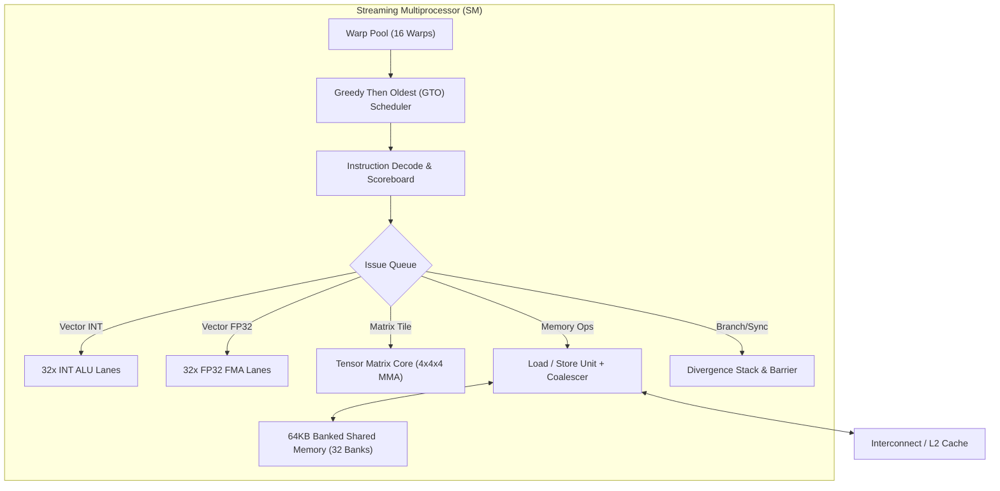

# zGPU Architecture Specification & Design Prototype v1.0

## 1. Executive Summary

**zGPU** is a high-throughput, general-purpose SIMT (Single Instruction, Multiple Threads) graphics and compute accelerator architecture. Designed as an open, modular silicon/FPGA and software-emulated prototype, zGPU targets parallel tensor workloads, deep neural network inference, and raster/compute graphic pipelines.

### Key Architectural Metrics:
- **Execution Model**: SIMT with lockstep Warp execution (32 lanes per Warp).
- **Core Organization**: Hierarchical (GPU → Compute Clusters → Streaming Multiprocessors [SM] → Warp Schedulers → Vector Execution Units).
- **Instruction Set**: 32-bit fixed-length RISC-V SIMT vector extension hybrid (`zISA`).
- **Memory Hierarchy**:
  - Per-thread Private Registers (128 registers $\times$ 32 bits = 512B / thread).
  - Shared Memory / L1 Scratchpad (64 KB per SM, 32 banks, bank-conflict detection).
  - Unified L2 Cache (512 KB - 2 MB coherent banked cache with write-back).
  - High-Bandwidth Device Memory (HBM2 / GDDR6 memory controllers).
- **Compute Precision**: FP32, FP16, BF16, INT32, INT8, and Tensor Core Matrix Engine (4x4x4 FP16 GEMM MMA operations).

```
                      +---------------------------------------+
                      |          Host PCIe 5.0 Bus            |
                      +-------------------+-------------------+
                                          |
                               +----------v----------+
                               |   Command Processor |
                               |   & Warp Dispatcher |
                               +----------+----------+
                                          |
                      +-------------------+-------------------+
                      |                                       |
           +----------v----------+                 +----------v----------+
           | Compute Cluster 0   |                 | Compute Cluster 1   |
           | +-----------------+ |                 | +-----------------+ |
           | |  SM 0    SM 1   | |                 | |  SM 2    SM 3   | |
           | +-----------------+ |                 | +-----------------+ |
           +----------+----------+                 +----------+----------+
                      |                                       |
                      +-------------------+-------------------+
                                          |
                               +----------v----------+
                               |  Unified L2 Cache   |
                               +----------+----------+
                                          |
                               +----------v----------+
                               | Device Memory (HBM) |
                               +---------------------+
```

---

## 2. Streaming Multiprocessor (SM) Microarchitecture

Each zGPU SM contains:
1. **Warp Scheduler & Instruction Buffer**:
   - Manages up to 16 active warps (512 concurrent threads per SM).
   - Dual-issue opportunistic out-of-order scoreboarding.
   - Dynamic Divergence Stack (Active Mask / Reconvergence IP stack).
2. **Execution Pipelines**:
   - **ALU Pipe**: 32-lane integer and logical units (1 cycle latency).
   - **FPU Pipe**: 32-lane single-precision IEEE 754 arithmetic (ADD, MUL, FMA, 3 cycle latency).
   - **Tensor Unit (MMA)**: Matrix Multiply-Accumulate performing $D = A \times B + C$ (4x4 tile FP16 in, FP32 accum).
   - **LSU (Load/Store Unit)**: 32-lane coalesced memory access with bank-conflict arbitrator.
   - **Branch / Control Unit**: Handles divergence, reconvergence, barriers (`SYNCWARP`, `BARRIER`).



---

## 3. Instruction Set Architecture (`zISA`)

All instructions are 32-bit aligned words.

| Format | Bit Fields | Description |
|---|---|---|
| **R-Type** | `opcode[6:0]`, `rd[11:7]`, `funct3[14:12]`, `rs1[19:15]`, `rs2[24:20]`, `funct7[31:25]` | Vector / scalar register-register ops |
| **I-Type** | `opcode[6:0]`, `rd[11:7]`, `funct3[14:12]`, `rs1[19:15]`, `imm[31:20]` | Memory loads, immediate arithmetic |
| **S-Type** | `opcode[6:0]`, `imm4:0[11:7]`, `funct3[14:12]`, `rs1[19:15]`, `rs2[24:20]`, `imm11:5[31:25]` | Vector stores |
| **B-Type** | `opcode[6:0]`, `imm[11:7]`, `funct3[14:12]`, `rs1[19:15]`, `rs2[24:20]`, `imm[31:25]` | Warp branch / divergence divergence |
| **M-Type** | `opcode[6:0]`, `rd[11:7]`, `funct3[14:12]`, `rs1[19:15]`, `rs2[24:20]`, `rs3[31:27]`, `fmt[26:25]` | Tensor matrix multiply-accumulate |

### Fundamental Opcodes:
- `NOP` (0x00)
- `ADD.V`, `SUB.V`, `MUL.V` (Vector 32-bit Integer)
- `FADD.V`, `FMUL.V`, `FFMA.V` (Vector 32-bit Floating Point)
- `LOAD.G`, `STORE.G` (Global Coalesced Memory Access)
- `LOAD.S`, `STORE.S` (Shared Memory Access)
- `BRA.DIV` (Branch with divergence pushing mask to stack)
- `JOIN` (Reconverge divergent execution paths)
- `BAR.SYNC` (Thread Block barrier synchronization)
- `MMA.SYNC` (4x4 Tensor Core Matrix Multiply)
- `HALT` (Kernel execution completion)

---

## 4. Software Stack & Ecosystem

```
+-------------------------------------------------------+
| Application (PyTorch / C++ High Performance Kernels) |
+-------------------------------------------------------+
                           |
+--------------------------v----------------------------+
| zRuntime Driver API (Memory Alloc, Kernel Launch)     |
+-------------------------------------------------------+
                           |
+--------------------------v----------------------------+
| zAssembler & Compiler Toolchain (zASM -> bytecode)    |
+-------------------------------------------------------+
                           |
+--------------------------v----------------------------+
| zGPU Cycle-Accurate Functional Engine & Simulator    |
+-------------------------------------------------------+
```
